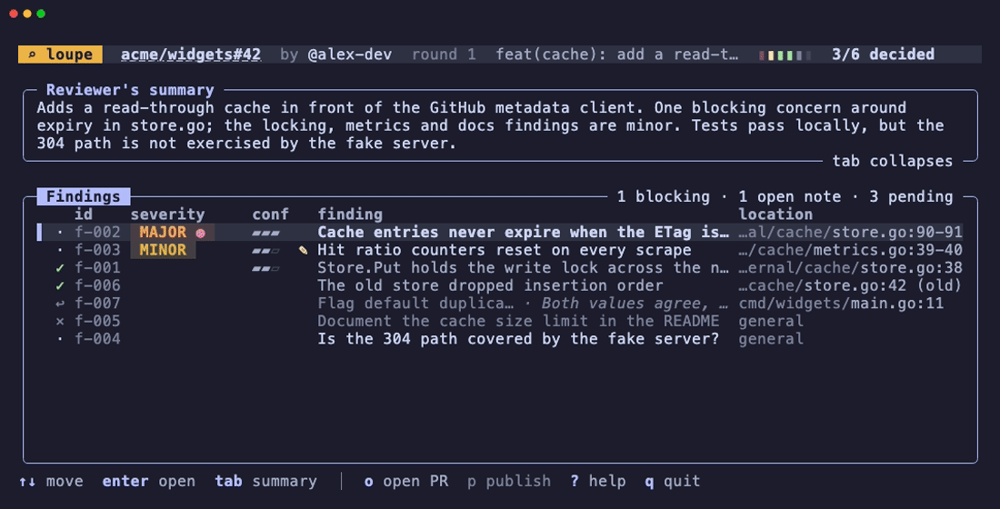

<h1>
  <picture>
    <source media="(prefers-color-scheme: dark)" srcset="docs/assets/logo-dark.png">
    
  </picture>
</h1>

[](https://github.com/secondshift-labs/loupe/releases/latest) [](https://github.com/secondshift-labs/loupe/actions/workflows/ci.yml) [](https://codecov.io/gh/secondshift-labs/loupe)

loupe lets developers who review code with an AI agent decide each of the agent's findings before anything is published.

A review agent that posts straight to GitHub puts unread comments under your name. With loupe, the agent files its findings into a local draft instead. You accept, rewrite or drop each finding in a terminal review window, write the review's opening, and confirm once to post a single GitHub review. For local work, such as uncommitted changes, a plan or a spec, you decide the findings the same way, and loupe returns your decisions to the agent that applies them.



## Quick start

Install the binary and the agent plugin:

```sh
curl -fsSL https://secondshift-labs.github.io/loupe/install.sh | sh
```

The script checks the download against the release's checksum and puts `loupe` in `~/.local/bin`. Then it installs the agent plugin, at the same release, into each of Claude Code, Codex and Pi that it finds on your `PATH`. loupe runs on Linux and macOS, on amd64 and arm64, and needs `git`. `loupe update` updates the binary and the plugins together, and `loupe uninstall` removes both and keeps your review runs. [Install](docs/install.md) covers the script's options, mise, release archives and GitHub Actions.

Then start your agent in a clone of the repository and ask it for a review:

```text
Review https://github.com/owner/repo/pull/123 and hand me the findings in loupe.
```

The agent opens `loupe review` in a pane beside its own in Herdr, tmux, Orca, iTerm2 or Ghostty. Elsewhere, it asks you to run `loupe review` yourself.

To try the review window without a pull request or an agent, run the demo from a clone of loupe. It needs [mise](https://mise.jdx.dev):

```sh
git clone https://github.com/secondshift-labs/loupe.git
cd loupe
mise trust && mise install
mise run demo
```

The demo opens `loupe review` on seeded runs against an in-memory GitHub, so nothing leaves the machine.

## Usage

### Review a pull request

1. Ask your agent for a review, as in the quick start. The agent captures the pull request into a *run*: a local draft of one review round, named like `owner/repo#123@1`. It files each *finding* into the run. A finding is a title and a Markdown body, pinned to a line of the diff or general.
2. Decide each finding in `loupe review`. You accept it, rewrite it, exclude it, or send it back with a note. The agent, blocked on `loupe wait`, gets the note, replies or edits the finding, and you see its answer in the same window.
3. Publish. Press `p` in `loupe review`, or run `loupe publish`. The confirmation shows the review as it will read, with its exact Markdown one key away. You type the review's opening, and `y` posts one GitHub review.

<picture>
  <source media="(prefers-color-scheme: dark)" srcset="docs/assets/review-dark.png">
  
</picture>

This is what a published review looks like. A CI review uses the same format.

After the author pushes, ask for another round. The agent sees what you published last time and what other reviewers said, so it re-raises only what is still open. `loupe publish --sticky` keeps one review per pull request current.

### Decide local work

Ask your agent to route its findings on local work through loupe:

```text
Review my uncommitted changes and let me decide the findings in loupe.
```

The agent captures the work with `loupe capture --changed`, or with `--files <path>` for a plan or a spec. That makes a *local run*, such as `owner/repo:local#7`, with no network call. Each finding shows the change the agent will make if you accept it. Once you decide the last one, you return the run, and the agent applies what you accepted. Nothing reaches GitHub. [Local work](docs/review-workflow.md#local-work) has the steps.

### Count your decisions

`loupe stats` totals your decisions across runs: how many findings the agent filed, how many you published and how many you rejected.

```sh
loupe stats --group-by month
```

## Configuration

loupe reaches GitHub with the token in `GH_TOKEN` or `GITHUB_TOKEN`, or else the one `gh auth login` stored, so a signed-in `gh` needs no setup.

Runs are stored under `$XDG_DATA_HOME/loupe`, else `~/.local/share/loupe`. Set `LOUPE_HOME` to store them elsewhere. [Environment](docs/review-workflow.md#environment) lists every variable.

To stop your agent asking for approval at each hand-off, allow `loupe handoff`. [Handing off in a terminal pane](docs/review-workflow.md#handing-off-in-a-terminal-pane) gives the rule.

## How it works

- **Nothing posts under your name unread.** You decide each finding yourself, you write the review's opening, and one confirmation sends one review. Only you run `loupe review` and `loupe publish`. Both refuse without an interactive terminal, except the unattended publish that CI uses.
- **Any review agent works.** loupe has no opinion on how findings are found. The agent files them through the `loupe` CLI, and the plugin's `human-review` and `human-decide` skills teach it the workflow. To connect a review skill you already have, see [the review workflow](docs/review-workflow.md#adapting-a-review-skill-you-already-have).
- **Findings are files on disk.** Each run is one directory under the data root, with no daemon, no database and no service to sign up for. Capture adds Git objects and private refs to your clone, and never changes your working files, index or branch.
- **Human and bot reviews read the same.** A CI job can publish through loupe too, with no one watching. Its review uses the same comment format, is marked unattended, and never approves or blocks a merge.

## Documentation

- [Install](docs/install.md): the binary, the agent plugin for each host, and updating or removing the two together.
- [The review workflow](docs/review-workflow.md): the attended loop, local work, the pane hand-off, and the command and environment reference.
- [Unattended reviews in CI](docs/ci-action.md): the GitHub Action, the pipeline and the rules an unattended review follows.
- [Comment format](docs/comment-format.md): the full reference for a published review, for anyone building on it.
- [Withdrawal reasons](docs/reason-codes.md): how an agent says why it withdrew a finding, and the recommended reason codes.
- [CLI contract](specs/001-loupe-v1/contracts/cli.md): commands, input, results and errors, for scripting against loupe.
- [Constitution](.specify/memory/constitution.md): the seven principles every change answers to.

## Development

loupe is written in Go. It uses [mise](https://mise.jdx.dev) for Go and its tools, and [lefthook](https://lefthook.dev) for git hooks. From a clone:

```sh
mise trust && mise install
mise exec -- lefthook install
mise run check
```

`mise run check` runs `go vet`, `golangci-lint`, `actionlint`, `shellcheck`, a test-hygiene check and `go test ./...`. [Contributing](CONTRIBUTING.md) covers local development, tests, commits and releases. [Security](SECURITY.md) says how to report a vulnerability.

## License

MIT. See [LICENSE](LICENSE).
