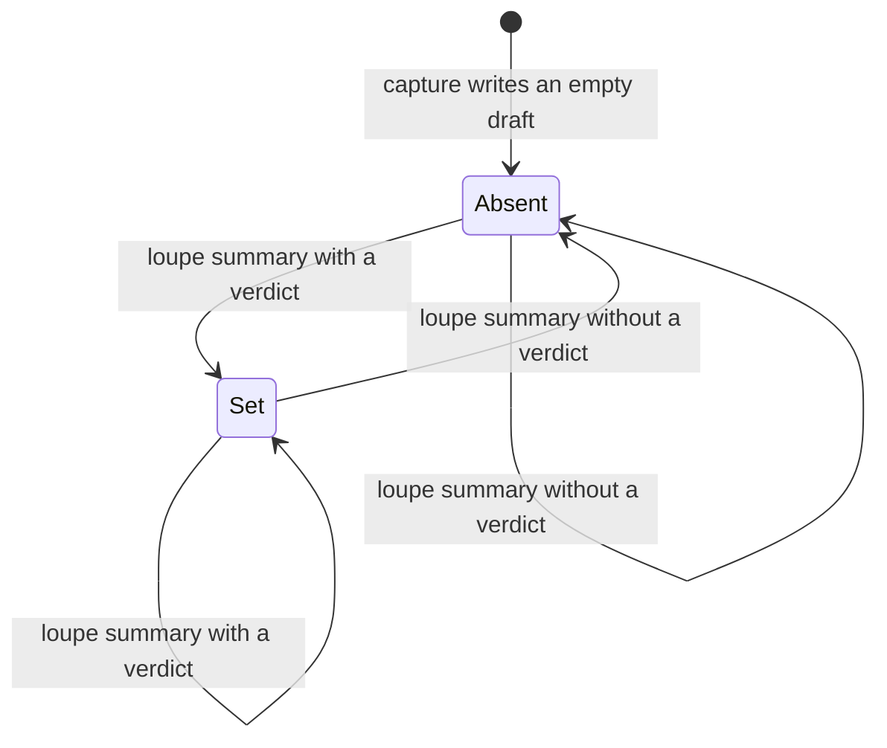

# Data model: Recommended verdict

Every record follows `docs/versioning.md`. The one new field only adds, so `ReadJSON` gains no migration step.

## draft.json, schema 8

Schema 8 adds one field to schema 7. Every other field is unchanged.

| Field | Type | Rule |
| :--- | :--- | :--- |
| `verdict` | string | `omitempty`. One of `comment`, `approve` or `request-changes` when `loupe summary` writes it. Absent on a local run and when the agent gave none |

- `loupe summary` by the agent sets it in the same mutation as `summary` and clears it when the call carries none. `--by human` keeps it.
- `loupe edit`, the human's decisions, `loupe review` and `loupe summary --by human` never change it.
- A new round's capture writes an empty draft, so the field starts absent each round.
- The digest does not include it. The draft's `version` counter still moves once per `summary` call.

The schema table in `internal/publish/schema_test.go` gains an `8:` entry: the schema 7 field set plus `verdict,omitempty`. The draft row of `docs/versioning.md` adds "8 added `verdict` (`specs/059-recommended-verdict`)".

## Derived values, never stored

| Value | Derived from | Read by |
| :--- | :--- | :--- |
| Start | `verdict`, `draft.PublishableSet`, and the viewer and author recorded at capture, through `publish.StartAction` | The action step, each time `p` opens it from the list |
| Reason (`why`) | The same call. A few words, empty when the start equals the verdict | The verdict's row in the action step |

