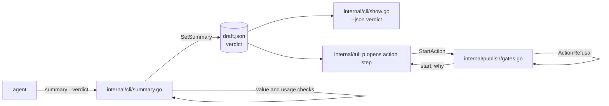

# Implementation Plan: Start the publish modal on the agent's recommended verdict

**Branch**: `docs/recommended-verdict-spec` | **Date**: 2026-11-20 | **Spec**: [spec.md](spec.md)

**Input**: Feature specification from `specs/059-recommended-verdict/spec.md`

## At a glance

- **Change**: `loupe summary` stores an optional `verdict` on the draft (schema 8). A new `publish.StartAction` picks the action step's start from it and returns a reason when the decisions override it.
- **Shared logic**: `ActionRefusal` and `StartAction` read one blocking set through a new `blockingIDs`, as FR-007 requires.
- **Size**: about 110 lines of production code in ten files, plus tests, help text, two contract amendments, the skill and the demo seed.
- **Constitution**: no violation. No GitHub request, refusal code, exit code or published byte changes.
- **Decision for the owner**: none before tasks. The by-eye check of the popup in the demo MAY lead to a styling round, as spec 056's did.

## Summary

The agent passes `--verdict` or `"verdict"` to `loupe summary`. `runSummary` checks the value against `publish.Actions` and refuses the bad cases from `contracts/cli-059.md`. `draft.SetSummary` stores the verdict beside the summary, and an agent call without one clears it. `loupe show --json` reports it. In the review program, `p` asks `publish.StartAction` for the start and the reason. The action step opens the cursor on that start, marks the verdict's row `recommended`, and on an override gives the reason on that row (research D10). The decisions in the research are in [research.md](research.md), the record in [data-model.md](data-model.md), and the contract text in [contracts/](contracts/).

## Technical Context

**Language/Version**: Go 1.26.

**Primary Dependencies**: None added.

**Storage**: `draft.json` gains `verdict`, `omitempty`. Schema 7 becomes 8, additive, with no migration step.

**Testing**: `internal/publish` table tests for `StartAction` and the schema table. `internal/cli` tests for the refusals, the clear-on-omit rule and `show --json`. `internal/mode` for the `wrong-mode` case. `internal/tui` view and key tests with injected keys for the start, the mark and the reason. One `internal/integration` test runs `summary --verdict` and reads it back with `show --json`.

**Target Platform**: Linux and macOS, as today.

**Project Type**: CLI.

**Constraints**:

- A run with no verdict draws the action step byte for byte as today (SC-004).
- The blocking set has one source (FR-007).
- No action row wraps at 80 columns (FR-010a, after the owner's demo review). `research.md` D10 supersedes the reason-row design of D5 and D6.

**Scale/Scope**: about 110 production lines and the tests, help, contract, skill and demo changes in the Files table.

## Constitution Check

The check is against constitution 4.0.0.

- **I**: The verdict is plain input to an existing command, open to any agent with a shell, and `loupe summary --help` documents it. The skill text only tells agents to pass it.
- **II**: The verdict moves the cursor only. The human still picks the action with enter, writes the opening prose, and confirms with `y` in one interactive command. An agent still cannot set the published action, and `--by human` cannot set a verdict that the modal would label as the agent's. An unattended publication still sends COMMENT.
- **III**: No new network access, daemon or file. The verdict lives in the run's existing `draft.json`.
- **IV**: The user's checkout is untouched.
- **V**: The verdict is accepted from `--from` input as well as a flag. Each refusal names its reason and fix. `show --json` gains one optional key in the same `"loupe": 1` envelope. The draft schema bumps under `docs/versioning.md`, and the schema test pins schema 8.
- **VI**: One new exported function, `StartAction`, and one helper, `blockingIDs`, which has two callers. No new type, dependency or abstraction.
- **VII**: Tests use local Git repositories, the fake GitHub and injected keys. No pseudo-terminal and no live publication.

Post-design re-check: unchanged. The design adds no item to Complexity Tracking.

## Project Structure

### Documentation (this feature)

```text
specs/059-recommended-verdict/
├── spec.md
├── plan.md              # this file
├── research.md          # D1–D9
├── data-model.md        # draft.json schema 8, derived start and reason
├── quickstart.md        # automated and by-eye checks
├── contracts/
│   ├── cli-059.md       # amendments to specs/001-loupe-v1/contracts/cli.md
│   └── layout-059.md    # amendment to specs/038-review-visual-design/contracts/layout.md
└── checklists/requirements.md
```

### Source code



## Files

| File | Change |
| :--- | :--- |
| `internal/draft/model.go` | `SchemaVersion` 7 → 8. `Draft` gains `Verdict string \`json:"verdict,omitempty"\`` after `Summary` |
| `internal/draft/mutate.go` | `SetSummary(d, summary, verdict, expectFindings, by)` assigns `d.Verdict = verdict` after its checks pass |
| `internal/draft/*_test.go` | Callers pass the verdict. One test: set, then a call without one clears it |
| `internal/cli/summary.go` | `--verdict` flag and `summaryInput.Verdict *string`. Before `resolveRun`: `ConflictsWithFrom(cmd, "body", "verdict")`, the flag value check and the `--by human` check. After decoding: the input value check, the `--by human` check, and the local-run key check (D8, D9). Help text and one example from `contracts/cli-059.md` |
| `internal/cli/summary_test.go` | One case per row of the refusal table, the flag and input forms, and clear-on-omit |
| `internal/mode/apply.go`, `mode_test.go` | `Refuses` gains `case "summary"` for the `verdict` flag (D8) |
| `internal/cli/show.go`, `show_test.go` | `payload["verdict"] = d.Verdict` when not empty. The help's result shape names it |
| `internal/publish/gates.go` | `blockingIDs(d)`, used by `ActionRefusal`. `StartAction(verdict, viewer, author, d) (string, string)` per the spec's flow and D3, D4 |
| `internal/publish/gates_test.go` | A `StartAction` table: 3 verdicts and none × blocking accepted, excluded, unblocked and absent × own pull request or not. Each row asserts the start, the `why`, and that `ActionRefusal` accepts the start |
| `internal/publish/schema_test.go` | Add the `8:` field set |
| `internal/tui/app.go` | `Model` gains `startWhy string` |
| `internal/tui/modeui.go` | `p` sets `m.pick` to the index of the start and `m.startWhy` to `why` (D7) |
| `internal/tui/list.go` | `actionView` gives the verdict's row `recommended` and, on an override, the reason in place of its description, and every other unavailable row `unavailable` and `publish.Unavailable`'s short reason. `pickerRow` takes a `pickerText` with a toned lead word. The descriptions are shortened (D10, which replaced the reason rows of D5 and D6) |
| `internal/tui/*_test.go` | View tests at 80 and 100 columns for a start on the verdict, each of the three reasons, an unavailable recommended row, and no verdict against today's frame. A key test: esc from the inline step returns to the human's action. A short-height test: the reason stays whole |
| `internal/integration/*_test.go` | `summary --verdict approve`, then `show --json` carries `verdict`, then `summary` without one drops it |
| `cmd/loupe-demo/seed.go` | Seed `verdict` `approve` on #43 and `request-changes` on #44, so the demo shows an override and a plain start |
| `testdata/golden/cli/show-help.*.txt` | Regenerate with `-update`, then read the diff |
| `specs/001-loupe-v1/contracts/cli.md` | Apply `contracts/cli-059.md` |
| `specs/038-review-visual-design/contracts/layout.md` | Apply `contracts/layout-059.md` |
| `docs/versioning.md` | Draft row: schema 8 added `verdict` |
| `plugin/skills/human-review/SKILL.md` | Section 5: pass the verdict the agent would publish with, `--verdict` or `"verdict"`. Say that it only sets where the human's publish step starts and that the human's decisions override it (FR-014) |

## Order of work

1. `publish`: `blockingIDs`, then `StartAction` and its table, failing test first.
2. `draft`: the field, the schema bump, `SetSummary`, and the schema test.
3. `cli` and `mode`: the flag, the input field, the refusals, `show --json`, help and goldens.
4. `tui`: the start, the mark and the reason on the agent's row, with view and key tests.
5. Demo seed, skill, contracts and `versioning.md`.
6. `mise run check`, then the by-eye pass in [quickstart.md](quickstart.md).

## Verification

- `go test ./internal/publish/ ./internal/draft/ ./internal/mode/ ./internal/cli/ ./internal/tui/ ./internal/integration/` after each step.
- `go test ./internal/cli/ -update`, then `git diff testdata/golden`. Only `show-help.80.txt` and `show-help.100.txt` change.
- `mise run check`, plus patch coverage per `CONTRIBUTING.md`.
- By eye: the quickstart's tmux steps on demo runs #43 and #42, in color, with `NO_COLOR=1`, and at 80×24.
- Unverified: nothing new. No GitHub behavior changes.

## Complexity Tracking

No constitution violations. The departures from `contracts/cli.md` and the 038 layout contract are the amendments in `contracts/`, which FR-014 names.
