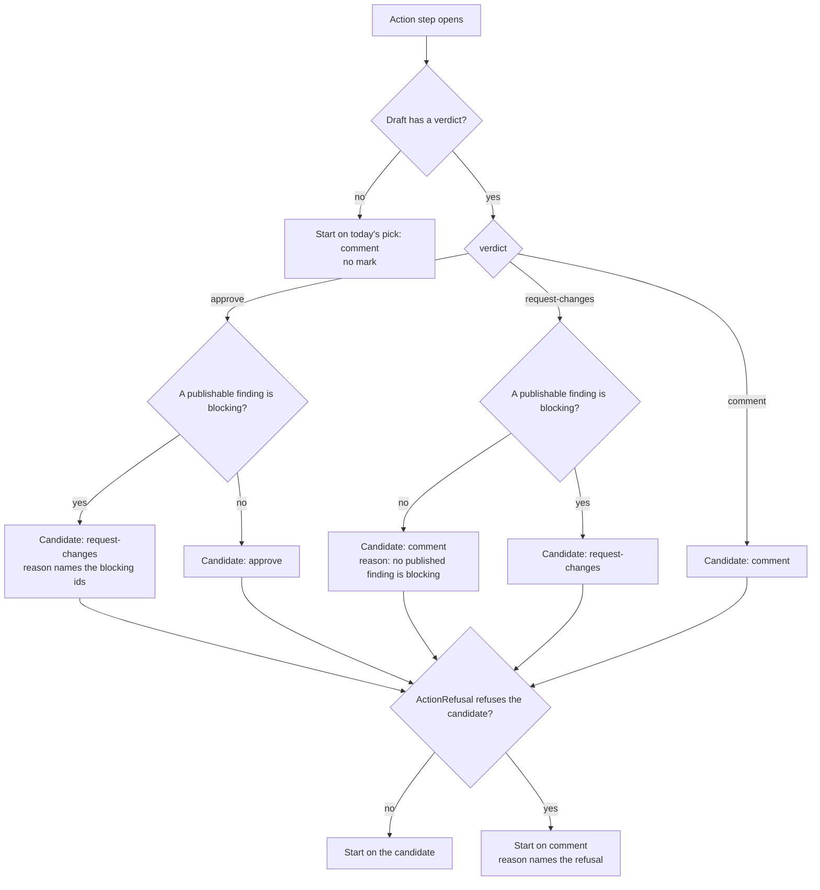

# Feature Specification: Start the publish modal on the agent's recommended verdict

**Feature Branch**: `059-recommended-verdict`

**Created**: 2026-11-20

**Status**: Draft

**Input**: Owner request, 2026-11-20: the publish modal always starts on `comment`, although the review agent usually says in chat which verdict it would give, and loupe never records it. The modal SHOULD start on the agent's recommendation. The human's own decisions MUST still win when they contradict it.

## At a glance

- **Subject**: the action step of the publish modal in `loupe review` starts on a verdict that the agent recorded with `loupe summary`, and marks it `recommended`.
- **Mechanism**: a new optional `--verdict comment|approve|request-changes` flag and `"verdict"` input field on `loupe summary`, stored on the round's draft (draft schema 8). No new command.
- **Override**: an accepted blocking finding turns `approve` into `request-changes`, no publishable blocking finding turns `request-changes` into `comment`, and an unavailable action falls back to `comment`. A note in the popup names the reason. The agent's row says why, as `recommended · f-002 is blocking`.
- **Size**: one draft field, one flag, a start rule in the modal, help, contract, skill and design-doc text. One `loupe show --json` field. No GitHub request, refusal code or published byte changes.
- **Settled by the owner**: with no verdict, the modal keeps today's `comment` start. Beyond the modal, the verdict reaches only `loupe show --json`, so the agent can read back what it set. Nothing is open.

## Relationship to earlier specifications

- It adds to the `loupe summary` section of `specs/001-loupe-v1/contracts/cli.md`: a `--verdict` flag and a `"verdict"` input field. It adds one row to the table of finding fields by run kind at the top of that file. It adds an optional `verdict` field to the `loupe show --json` result. The summary's `--json` result does not change. No refusal code or exit code is added.
- It adds the `verdict` field to the draft, which bumps the draft `schema` from 7 to 8 under `docs/versioning.md`. The bump only adds a field, so no reader migrates.
- It amends the publish popup paragraph of `specs/038-review-visual-design/contracts/layout.md`: the agent's row reads `recommended ·` and, when the start differs from the verdict, the reason. Every unavailable row gets a short reason in place of the whole refusal, and the descriptions are shortened (owner, after the demo).
- It reuses `publish.ActionRefusal` (`internal/publish/gates.go`) for availability and for the set of blocking findings. It adds no rule about own pull requests or blocking findings.
- `loupe publish --action` does not change. `--action` stays required, and the verdict never supplies it.
- `specs/007-unattended-publish` does not change. An unattended publication still sends COMMENT whatever the verdict says.
- `specs/049-apply-mode` does not change. A local run has no publish action step, so it takes no verdict.
- `docs/comment-format.md`, the digest, the attempt, the receipt, the `loupe-meta` marker, `loupe stats` and the published review do not change.
- Constitution 4.0.0 is unchanged. Principle II holds: the verdict only moves the cursor. The human still picks the action with enter and confirms the review with `y` in one interactive command. An agent still cannot publish or set the action.

## Clarifications

### Settled by the owner, 2026-11-20

- Q1: With no agent verdict, does the modal derive its start from the decisions alone, for example `request-changes` when a publishable finding is blocking? → A: No. The modal keeps today's `comment` start, with no mark and no reason row. A derived start would be loupe's own verdict, and nothing in the modal would say who made it. The same rule covers an agent that recommended `comment` while the human accepted a blocking finding: the start stays on `comment` (FR-012, Edge Cases).
- Q2: Does the verdict reach anything beyond the modal's start? → A: Only `loupe show --json`, so the agent can read back what it set. It does not reach `loupe show` without `--json`, the `summary` result, the attempt, the receipt, the `loupe-meta` marker, `loupe stats` or the published review (FR-015).

### Settled by the owner after seeing the demo, 2026-11-20

- Q: The first build drew `recommended ·` before the full refusal on the agent's row, and a separate reason line under the choices. The owner found it very cluttered: the blocking ids showed twice, and the long refusal wrapped. How does the step read instead? → A: The reason goes on the agent's own row, as `recommended · f-002 is blocking`, with `recommended` in the good tone and the reason in the warn tone. The separate line goes. Every unavailable row reads `unavailable · <short reason>`, and the action descriptions are shortened, so no row wraps at 80 columns. Enter on an unavailable row still shows the whole refusal and its fix. The owner picked this over a deduplicated reason line and over a header line under the tabs.

### Settled in this specification

- Q: Where does the agent state the verdict? → A: On `loupe summary`, as `--verdict` with `--body` and as `"verdict"` in the `--from` input. The agent already calls `summary` once per round, after it files its findings and states its view of the round. Rejected: a new command, which the brief rules out while an existing one fits. Also rejected: a field on `loupe capture`, which runs before the review exists, and a field on the target, which capture writes and nothing changes after.
- Q: Where is the verdict stored? → A: On the draft, beside the summary. A round's draft is the only record that the agent writes and the modal reads. A new round's capture starts an empty draft, so the verdict does not carry into the next round. The agent states it again with that round's summary.
- Q: Does `loupe edit` keep the verdict? → A: Yes. `edit` changes findings, never the summary or the verdict. A human decision changes the start only through the override rule (FR-006 to FR-008), not by clearing the verdict.
- Q: Does a `summary` call without a verdict keep the earlier one? → A: No. A `summary` call sets the agent's whole view of the round, and a verdict that is absent from the call is cleared. A stale verdict is worse than none, because the modal would start on it.
- Q: Does "blocking" in the override mean the set that `ActionRefusal` uses? → A: Yes. It is the publishable set's findings marked blocking. The action step opens only on a ready draft, so that set is the accepted findings. The override and the `blocking` refusal can then never disagree.
- Q: Does `request-changes` turn into `comment` when the agent never filed a blocking finding? → A: Yes. The rule is that no publishable finding is blocking, however that came about. A `request-changes` review whose published findings block nothing contradicts what it posts, and one rule is easier to read in the note than two.
- Q: Does the agent's row stay marked when the modal starts elsewhere? → A: Yes. The `recommended` mark stays on the agent's verdict, available or not, and the row itself says why the cursor is elsewhere. The human then sees both what the agent said and what the decisions changed.
- Q: Can `--by human` set a verdict? → A: No. The modal shows the verdict as the agent's recommendation, so a human-set verdict would be mislabeled. The human picks the action in the modal.

## How the start is chosen

`comment` is never refused, so the last step always lands on an available action. The availability check is the same `ActionRefusal` call that marks a row `unavailable` today.

## User Scenarios & Testing *(mandatory)*

### User Story 1 - The modal starts on the agent's verdict (Priority: P1)

The agent reviews a pull request and finds nothing that blocks it. It files two findings that do not block and sets the summary with `--verdict approve`. The human accepts both findings and presses `p`. The action step opens on `approve`, and the approve row is marked `recommended`. The human presses enter.

**Why this priority**: This is the whole ask. Without it, the human moves the cursor on every review where the agent's verdict is not `comment`.

**Independent Test**: Seed a pull request run with a verdict through `loupe summary`. In the review program, with injected keys, decide every finding, press `p`, and read the action step.

**Acceptance Scenarios**:

1. **Given** a draft whose verdict is `approve` and whose accepted findings do not block, **When** the human opens the action step, **Then** the cursor starts on `approve`, and only that row carries the `recommended` mark.
2. **Given** a draft whose verdict is `request-changes` and an accepted finding that blocks, **When** the human opens the action step, **Then** the cursor starts on `request-changes`, marked `recommended`.
3. **Given** a draft whose verdict is `comment`, **When** the human opens the action step, **Then** the cursor starts on `comment`, marked `recommended`.
4. **Given** the cursor on the recommended row, **When** the human moves it and presses enter, **Then** the chosen action goes on to the inline step as today. The verdict does not change.
5. **Given** a start equal to the verdict, **When** the action step shows, **Then** the verdict's row reads `recommended ·` and the action's description.

---

### User Story 2 - The human's decisions override the verdict (Priority: P1)

The agent recommended `approve`, but the human accepted a finding the agent marked blocking. The action step starts on `request-changes`. The `approve` row reads `recommended · f-002 is blocking`. In another run the agent recommended `request-changes`, and the human excluded the one blocking finding. The step starts on `comment` and says why.

**Why this priority**: The owner requires the human's decisions to win. A start that contradicts the decisions invites a hurried wrong verdict under the human's name.

**Independent Test**: Seed runs with each verdict and with blocking findings accepted, excluded, withdrawn and unblocked. Open the action step and read the start and the agent's row.

**Acceptance Scenarios**:

1. **Given** a verdict of `approve` and one accepted blocking finding `f-002`, **When** the human opens the action step, **Then** the cursor starts on `request-changes`, and the `approve` row shows as unavailable and reads `recommended · f-002 is blocking`. No other line repeats the ids.
2. **Given** a verdict of `approve` and accepted blocking findings `f-002` and `f-005`, **When** the human opens the action step, **Then** the `approve` row reads `recommended · f-002, f-005 are blocking`. With more than three, it names two and counts the rest, as `f-002, f-005 and 3 more are blocking`.
3. **Given** a verdict of `request-changes` and every blocking finding excluded, withdrawn or unblocked by the human, **When** the human opens the action step, **Then** the cursor starts on `comment`, and the `request-changes` row reads `recommended · no published finding is blocking`.
4. **Given** an override, **When** the human moves the cursor, **Then** the agent's row keeps its reason until the step closes.
5. **Given** the human unblocks the finding after an override and opens the action step again, **When** the step opens, **Then** the start is worked out again from the current decisions.

---

### User Story 3 - An unavailable action is never the start (Priority: P1)

The human reviews their own pull request, and the agent recommended `approve`. Both `approve` and `request-changes` are unavailable. The step starts on `comment`. The `approve` row reads `recommended · your own pull request`, and the `request-changes` row reads `unavailable · your own pull request`.

**Why this priority**: Enter on an unavailable row refuses. A start there makes the first key press fail.

**Independent Test**: Seed a run whose viewer is the author with each verdict. Open the action step.

**Acceptance Scenarios**:

1. **Given** the viewer is the author and the verdict is `approve` or `request-changes`, **When** the action step opens, **Then** the cursor starts on `comment`, and the verdict's row reads `recommended · your own pull request`.
2. **Given** the viewer is the author, the verdict is `approve` and a publishable finding blocks, **When** the action step opens, **Then** the cursor starts on `comment`, and the verdict's row reads `recommended · your own pull request`.
3. **Given** any start, **When** the action step opens, **Then** `ActionRefusal` accepts the start action.

---

### User Story 4 - The agent records its verdict (Priority: P1)

The `human-review` skill tells the agent to pass its verdict when it sets the summary. The agent runs `loupe summary --expect-findings 2 --verdict approve --body "..."`, or puts `"verdict": "approve"` in the `--from` input.

**Why this priority**: Without a way to record the verdict, no start can follow it.

**Independent Test**: Run `loupe summary` against local Git repositories and the fake GitHub with each input form and each invalid case. Read the stored draft and the refusals.

**Acceptance Scenarios**:

1. **Given** a pull request run, **When** the agent runs `loupe summary --verdict approve --body <text> --expect-findings <n>`, **Then** the draft stores the summary and the verdict `approve` in one mutation.
2. **Given** a pull request run, **When** the agent passes `{"summary": "...", "verdict": "request-changes"}` with `--from`, **Then** the draft stores both.
3. **Given** a draft with a verdict, **When** the agent runs `loupe summary` again without a verdict, **Then** the draft has no verdict.
4. **Given** `--verdict` with a value other than the three actions, **When** the agent runs `summary`, **Then** loupe refuses `usage`, names the three values and leaves the draft unchanged. A bad `"verdict"` value in the input refuses `input` in the same way.
5. **Given** `--verdict` together with `--from`, **When** the agent runs `summary`, **Then** loupe refuses `usage` with the refusal it gives `--body` with `--from`.
6. **Given** a local run, **When** the agent passes `--verdict`, **Then** loupe refuses `wrong-mode`. **When** the agent passes `"verdict"` in the input, **Then** loupe refuses `input`, fix: drop it.
7. **Given** `--by human`, **When** a verdict is passed, **Then** loupe refuses `usage`, fix: drop the verdict.
8. **Given** no run, **When** the agent runs `loupe summary --help`, **Then** the help names `--verdict`, the `"verdict"` input field, the three values, and that the verdict only sets where the publish modal starts.
9. **Given** a draft with a verdict, **When** the agent runs `loupe show --json`, **Then** the result carries `verdict`. **Given** a draft without one, **Then** the result has no `verdict` key.

---

### Edge Cases

- No verdict: the modal behaves as today. It starts on `comment`, with no mark (Q1).
- The agent recommended `comment`, and the human accepted a blocking finding. The start stays on `comment`, because `comment` is available and the override rules cover only `approve` and `request-changes`. Decisions alone never move the start (Q1).
- The agent recommended `approve` with no findings at all. The start is `approve`.
- The human goes back from the inline step to the action step with esc. The cursor returns to the action the human chose, as today, not to the start rule.
- The human leaves the action step with esc and opens it again with `p`. The start is worked out again, because decisions can change in between.
- The viewer and author recorded at capture are out of date. The start uses the recorded pair, as the action step does today, and publish checks them again against GitHub.
- Many findings block. The agent's row names the first two and counts the rest, so the row stays one line at 80 columns and the choices keep their rows. A narrower popup wraps the row under the description column, as before.
- The agent sets a verdict, and a later round is captured. The new round has no verdict until the agent sets that round's summary.
- An older draft at schema 7 has no verdict. It reads as no verdict.
- An older loupe binary reads a schema 8 draft. It refuses `record` with the fix `upgrade loupe`, as `docs/versioning.md` already requires.
- `loupe publish --unattended` on a run with a verdict sends COMMENT. The verdict is ignored.

## Requirements *(mandatory)*

### Functional Requirements

- **FR-001**: `loupe summary` MUST accept an optional `--verdict` flag and an optional `"verdict"` field in its `--from` input, each one of `comment`, `approve` or `request-changes`, the values of `publish.Actions`.
- **FR-002**: `--verdict` with `--from` MUST refuse `usage` through the check that refuses `--body` with `--from`. `--verdict` MUST refuse `usage` with `--by human`. An unknown flag value MUST refuse `usage`, and an unknown input value MUST refuse `input`. A value refusal MUST name the three values. Every refusal MUST leave the draft unchanged.
- **FR-003**: On a local run, `--verdict` MUST refuse `wrong-mode`, and a `"verdict"` input key MUST refuse `input` with the fix to drop it, matching the run-kind table in `contracts/cli.md`.
- **FR-004**: `summary` MUST store the verdict on the draft in the same mutation as the summary, under the same lock, `--expect-version` and `--expect-findings` checks. A `summary` call without a verdict MUST clear a stored verdict.
- **FR-005**: The draft MUST gain an optional `verdict` field, and the draft `schema` MUST go from 7 to 8 under `docs/versioning.md`. The schema test MUST pin the schema 8 field set. The verdict MUST NOT enter the digest.
- **FR-006**: When the action step opens on a draft with a verdict, the start MUST follow the flow in "How the start is chosen". With verdict `approve` and a blocking finding in the publishable set, the candidate MUST be `request-changes`. With verdict `request-changes` and no blocking finding in the publishable set, the candidate MUST be `comment`. Otherwise the candidate MUST be the verdict.
- **FR-007**: The set of blocking findings MUST be the one `publish.ActionRefusal` reads. The implementation MUST share that logic with `ActionRefusal`, not restate it.
- **FR-008**: When `publish.ActionRefusal` refuses the candidate, the start MUST be `comment`.
- **FR-009**: The row of the verdict's action MUST open its description with `recommended` and the separator glyph, whether the step starts there or not and whether the action is available or not. `recommended` MUST be in the good tone and read under `NO_COLOR` as a plain word.
- **FR-010**: When the start differs from the verdict, the verdict's row MUST say why after `recommended ·`, in the warn tone, in place of the action's description. No other line MAY repeat it. The reason MUST be one of these:
  - `<ids> is blocking` or `<ids> are blocking`, for an approve that the decisions turned into request-changes. `<ids>` are the blocking ids in the publishable set, joined by `, `. More than three name the first two and end `and <n> more are blocking`.
  - `no published finding is blocking`, for a request-changes turned into comment.
  - `your own pull request`, when the start fell back to comment because of the `own-pr` rule.
- **FR-010a**: Every other unavailable row MUST read `unavailable ·` and the same short reason, in place of the whole refusal message. Enter on such a row MUST still show the whole refusal and its fix, as today. The action descriptions MUST be `post findings, no verdict`, `post findings and approve` and `post findings and request changes`, so that no row wraps at 80 columns.
- **FR-011**: The start MUST be worked out each time the action step opens from the list. Going back from the inline step MUST keep the human's choice, as today.
- **FR-012**: With no verdict, the action step MUST behave as today: start on `comment`, with no mark. loupe MUST NOT derive a start from the decisions alone (Q1).
- **FR-013**: The verdict MUST NOT change `loupe publish --action`, which stays required, and MUST NOT change an unattended publication, which still sends COMMENT.
- **FR-014**: `loupe summary --help`, `loupe show --help`, the `loupe summary` and `loupe show` sections and the run-kind table of `specs/001-loupe-v1/contracts/cli.md`, the publish popup paragraph of `specs/038-review-visual-design/contracts/layout.md`, the draft row of `docs/versioning.md`, and section 5 of `plugin/skills/human-review/SKILL.md` MUST describe the verdict. The skill SHOULD tell the agent to pass its verdict with the summary. The skill MUST say that the verdict only sets where the human's modal starts and that the human's decisions override it.
- **FR-015**: `loupe show --json` MUST carry the stored verdict as `verdict` and MUST omit the key when the draft has none. The verdict MUST NOT appear in `loupe show` without `--json`, the `summary` result, the attempt, the receipt, the `loupe-meta` marker, `loupe stats` or the published review (Q2).
- **FR-016**: Tests MUST use local Git repositories, the fake GitHub and injected terminal input (Principle VII). The goldens of `loupe summary --help` and of the action step MUST be regenerated deliberately.

### Key Entities

- **Verdict**: the agent's recommended action for one round, one of `comment`, `approve` or `request-changes`, or absent. It lives on the round's draft, `loupe summary` sets or clears it, the publish modal's action step reads it, and `loupe show --json` reports it.
- **Start**: the action the cursor rests on when the action step opens. It is derived from the verdict, the draft's publishable set and the viewer and author recorded at capture, each time the step opens. It is never stored.
- **Reason**: a few words on the verdict's row that explain a start that differs from the verdict. It is never stored and never published.

## Success Criteria *(mandatory)*

### Measurable Outcomes

- **SC-001**: On a run whose verdict is available and agrees with the decisions, the human publishes with the agent's verdict without moving the cursor on the action step.
- **SC-002**: On every seeded combination of verdict, blocking decisions and own pull request, the start is an action that `ActionRefusal` accepts.
- **SC-003**: Every start that differs from the verdict names the cause on the verdict's row, and no line repeats it.
- **SC-004**: A run with no verdict draws no `recommended` mark and starts on `comment`, as today. Its rows carry the shortened descriptions and unavailable reasons of FR-010a.
- **SC-005**: No published review, receipt, digest or `--json` result changes, apart from the `verdict` key of `loupe show --json`.
- **SC-006**: `mise run check` passes.

## Assumptions

- The agent states its verdict in chat today, so asking it to pass the same verdict to `summary` adds no review work. Agents that never pass it see no change.
- The action step opens only on a ready draft, so no finding is pending there, and the publishable set is the accepted findings.
- Finding ids on the agent's row are fine. The rule against finding ids (`specs/043-no-finding-ids`) covers agent-written text that reaches GitHub, and the modal already names ids in its `unavailable` rows.
- Out of scope: local runs, number keys for a question's options (rejected in `specs/049-apply-mode` F3), the pull request author in the review header (`feat/pr-author-header`), a verdict shown anywhere in `loupe review` outside the action step, and a reason the agent writes for its verdict.
