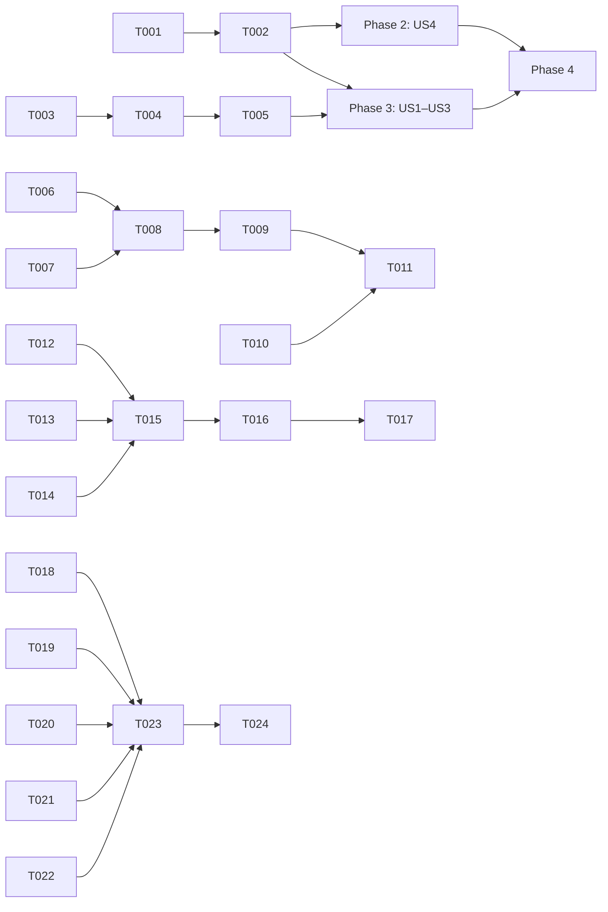

# Tasks: Start the publish modal on the agent's recommended verdict

**Input**: `specs/059-recommended-verdict/spec.md`, `plan.md`, `research.md`, `data-model.md` and `contracts/`

**Tests**: Required. The constitution orders each task as failing test, then implementation, then passing check.

## Phase 1: Foundational — the stored verdict and the start rule

**Goal**: the draft can hold a verdict, and `publish.StartAction` turns a verdict and the decisions into a start and a reason. Every user story reads one or both.

- [ ] T001 [P] In `internal/publish/schema_test.go`, add an `8:` entry to the `draft.Draft` table: the schema 7 field set plus `verdict,omitempty`. Run it and see it fail. Then, in `internal/draft/model.go`, set `SchemaVersion = 8` and add `Verdict string \`json:"verdict,omitempty"\`` to `Draft` right after `Summary`, with a one-line comment that says `loupe summary` sets it and only the publish step reads it. Run the schema test and see it pass.
- [ ] T002 In `internal/draft/mutate_add_test.go`, add a test: `SetSummary(d, "x", "approve", nil, ByHuman)` stores `Verdict == "approve"`, then `SetSummary(d, "y", "", nil, ByHuman)` leaves `Verdict == ""`. Add a case where a `count` refusal leaves the stored verdict unchanged. Run it and see it fail to compile. Then change `SetSummary` in `internal/draft/mutate.go` to `SetSummary(d *Draft, summary, verdict string, expectFindings *int, by string)` and assign `d.Verdict = verdict` beside `d.Summary`, after every check passes. Update every caller: `internal/cli/summary.go:97` passes `""` for now, and the tests in `internal/draft/mutate_add_test.go` and `internal/draft/mutate_findingid_test.go` pass `""`. Run `go test ./internal/draft/` and see it pass.
- [ ] T003 [P] In `internal/publish/gates_test.go`, add `TestStartAction`, a table over verdict (`""`, `comment`, `approve`, `request-changes`, `bogus`) × blocking state (no findings, a non-blocking finding accepted, a blocking finding accepted, a blocking finding excluded, a blocking finding accepted then unblocked with `draft.Edit` by the human) × own pull request (viewer equals author, or not). Each row asserts the start and `why` against the spec's "How the start is chosen" and FR-010 wordings: `agent recommended approve; f-002 is blocking`, `agent recommended approve; f-002, f-005 are blocking` (add a two-blocking row), `agent recommended request-changes; no published finding is blocking`, and `agent recommended <verdict>; you authored this pull request`. A `""` or `bogus` verdict gives `comment` and `""` (research D4). Every row also asserts that `ActionRefusal(start, viewer, author, d)` returns nil (SC-002). Run it and see it fail to compile.
- [ ] T004 In `internal/publish/gates.go`, extract `blockingIDs(d *draft.Draft) []string`, the ids of the findings in `draft.PublishableSet(d)` with `Blocking` set, and make `ActionRefusal` call it with no change in its messages. Run `TestActionRefusal` and see it still pass.
- [ ] T005 In `internal/publish/gates.go`, add `StartAction(verdict, viewer, author string, d *draft.Draft) (action, why string)`. It returns `comment, ""` for a verdict not in `Actions`. It picks the candidate from the verdict and `blockingIDs` as the spec's flow says, then calls `ActionRefusal` on the candidate. On a refusal it returns `comment` with `why` ending `you authored this pull request` for `refusal.OwnPR`, or the refusal's message for any other code (research D3). `why` is `""` when the start equals the verdict. Join ids with `, ` and use `is` for one id and `are` for more. Run `TestStartAction` and see it pass. Commit T001 to T005 as `feat(publish): derive the publish step's start from a verdict`.

## Phase 2: User Story 4 — the agent records its verdict (P1)

**Goal**: `loupe summary` stores the verdict from a flag or the input, refuses every bad case in `contracts/cli-059.md`, and `loupe show --json` reports it.

**Independent test**: `go test ./internal/cli/ ./internal/mode/ ./internal/integration/ -run 'Summary|Verdict|Show|Refuses'`.

- [ ] T006 [P] [US4] In `internal/mode/mode_test.go`, add a case: the apply mode's `Refuses("summary", []string{"verdict"})` returns `wrong-mode` with message `loupe summary --verdict applies only to pull request runs` and fix `run loupe summary without --verdict`, and `Refuses("summary", nil)` returns nil. The publish mode refuses neither. Run it and see it fail. Then add `case "summary"` to `Refuses` in `internal/mode/apply.go` for the `verdict` flag. Run it and see it pass.
- [ ] T007 [US4] In `internal/cli/summary_test.go`, add cases to `TestSummaryFlagRefusals`, and new tests where a table does not fit, for each row of the refusal table in `contracts/cli-059.md`: `--verdict` with `--from` (`usage`, the existing `--from cannot be combined with --verdict`), `--verdict maybe` (`usage`, message names `maybe` and `comment, approve or request-changes`, fix `use one of comment, approve or request-changes`), `{"summary": "x", "verdict": "maybe"}` (`input`, message names `"verdict"`), `--verdict approve --by human` and `"verdict"` with `--by human` (`usage`, fix `drop --verdict; the human picks the action in loupe review`), `--verdict` on a local run (`wrong-mode`), and `"verdict"` on a local run (`input`, message `input field "verdict" does not apply to local runs`, fix `drop "verdict" from the input`). Each case asserts that the draft version did not move. Add success cases: `--verdict approve --body x` and `{"summary": "x", "verdict": "request-changes"}` each store the verdict, and a later `summary --body y` clears it. Run them and see them fail.
- [ ] T008 [US4] In `internal/cli/summary.go`, add the `--verdict` flag ("the action you would publish with: comment, approve or request-changes") and `Verdict *string \`json:"verdict"\`` on `summaryInput`. Change the first check to `ConflictsWithFrom(cmd, "body", "verdict")`. Before `resolveRun`, refuse a flag value outside `publish.Actions` and a flag with `--by human`. After decoding `--from`, refuse an input value outside `publish.Actions` with `input`, and an input verdict with `--by human`. For a local run, load the target with `run.LoadTarget(dir)` and refuse an input verdict when `target.Kind == run.KindLocal` (research D8). Pass the verdict to `draft.SetSummary`. Run T007 and see it pass.
- [ ] T009 [US4] In `internal/cli/summary.go`, rewrite `summaryHelp` to carry the `contracts/cli-059.md` paragraph in its own words: the input shape `{"summary": "Markdown", "verdict": "approve"}`, the three values, that it sets only where the publish step starts, that the human's decisions override it, that `loupe publish --action` is still required, and that a call without a verdict clears it. Add `loupe summary --body "One blocking issue." --expect-findings 2 --verdict request-changes` to `Example`. Extend the summary case in `internal/cli/help_test.go` so it requires `--verdict` and `"verdict"` in the summary help.
- [ ] T010 [P] [US4] In `internal/cli/show_test.go`, add a test: `show --json` on a draft with verdict `approve` carries `"verdict": "approve"`, and on a draft without one has no `verdict` key. The text `show` prints no verdict. Run it and see it fail. Then, in `internal/cli/show.go`, set `payload["verdict"] = d.Verdict` when it is not empty, and add `"verdict": "approve"` to the result shape in `showHelp` with a note that it is absent when the agent gave none. Run `go test ./internal/cli/ -update`, then read `git diff testdata/golden`. Only `show-help.80.txt` and `show-help.100.txt` may change.
- [ ] T011 [US4] In `internal/integration`, beside the existing summary test, add one test against local Git repositories and the fake GitHub: capture a pull request, `add` one finding, `summary --verdict approve --expect-findings 1 --body x --json`, then `show --json` carries `verdict`, then `summary --expect-findings 1 --body y` without a verdict, then `show --json` has none. Commit T006 to T011 as `feat(cli): record the agent's verdict with loupe summary`.

## Phase 3: User Stories 1, 2 and 3 — the action step starts on the verdict (P1)

**Goal**: `p` opens the action step on `StartAction`'s start, marks the verdict's row `recommended`, and shows the reason when the start differs.

**Independent test**: `go test ./internal/tui/ -run 'Publish|Action|Verdict|Start'`.

- [ ] T012 [P] [US1] In `internal/tui/list_test.go`, add view tests at 80 and 100 columns, with and without color. A ready draft with verdict `approve` and no blocking finding: after `p`, the cursor row is `approve`, its description reads `recommended · post the findings and approve the pull request`, no other row carries `recommended`, and no reason row shows. Repeat for `request-changes` with a blocking finding accepted, and for `comment`. A draft with no verdict draws exactly the frame that `TestPublishStepsShowTabsAndPanes` pins today (SC-004). Run them and see them fail.
- [ ] T013 [P] [US2] In `internal/tui/list_test.go`, add view tests for the overrides. Verdict `approve` with `f-002` accepted as blocking: the cursor is on `request-changes`, the `approve` row reads `recommended · unavailable: cannot approve while publishable findings are blocking: f-002`, and a reason row under the choices reads `agent recommended approve; f-002 is blocking`. Verdict `request-changes` with the blocking finding excluded: the cursor is on `comment`, and the reason reads `agent recommended request-changes; no published finding is blocking`. Add a key test: after `j` the reason row still shows. Add a short-height test at the smallest height that draws the popup: the reason row stays whole while choices give way. Run them and see them fail.
- [ ] T014 [P] [US3] In `internal/tui/list_test.go`, add a view test where the target's viewer equals its author and the verdict is `approve`, with and without a blocking finding: the cursor is on `comment`, and the reason reads `agent recommended approve; you authored this pull request`. Add a key test that enter on the start goes to the inline step with no refusal notice. Run them and see them fail.
- [ ] T015 [US1] In `internal/tui/app.go`, add `startWhy string` to `Model`, with a one-line comment that `p` sets it and the action step draws it. In `internal/tui/modeui.go`, make `publishUI.listKey`'s `p` branch call `publish.StartAction(m.draft.Verdict, m.target.Viewer, m.target.Author, m.draft)`, set `m.pick` to `slices.Index(publish.Actions, start)` and `m.startWhy` to `why`.
- [ ] T016 [US1] [US2] In `internal/tui/list.go`, give `publishStep` a `why string` argument. When it is not empty, wrap it to `inner` in the secondary tone and put those rows before `m.noticeRows(inner, room)` in the notice passed to `withNotice`, so they sit under the choices and stay whole (research D6). `actionView` passes `m.startWhy`, and `inlineView` passes `""`. In `actionView`, when `m.draft.Verdict` names the row's action, prefix its description, available or unavailable, with `"recommended " + m.glyphs.Sep + " "` (research D5). Run T012 to T014 and see them pass.
- [ ] T017 [US1] In `internal/tui/list_test.go`, add a key test: from a start on `request-changes`, press `k`, enter, then esc on the inline step. The cursor is on `approve`, the action the human chose (FR-011). Then esc to the list and `p` again: the cursor is back on the start. Run it and see it pass with no change, or fix `updateInline`'s esc if it fails. Commit T012 to T017 as `feat(tui): start the publish step on the agent's verdict`.

## Phase 4: Polish — demo, skill, contracts and records

- [ ] T018 [P] In `cmd/loupe-demo/seed.go`, set the verdict per seeded run: `approve` on #43 and `request-changes` on #44, with #42 left without one. Pass it through `demoRun` with the run table rather than a global. Run `go test ./cmd/loupe-demo/`.
- [ ] T019 [P] In `plugin/skills/human-review/SKILL.md` section 5, add a paragraph: pass the action you would publish with as `--verdict` or as `"verdict"` in the `--from` input. Say that it only sets where the human's publish step starts, that the human's decisions override it, and that a later `summary` call without it clears it. Add `"verdict"` to the input shape the section shows. Run `go test ./internal/cli/ -run Plugin`.
- [ ] T020 [P] In `specs/001-loupe-v1/contracts/cli.md`, apply `specs/059-recommended-verdict/contracts/cli-059.md`: the run-kind table row, the `loupe summary` heading, input, paragraph and refusals, and the `loupe show` result line. Each change cites `specs/059-recommended-verdict`.
- [ ] T021 [P] In `specs/038-review-visual-design/contracts/layout.md`, add the paragraph from `specs/059-recommended-verdict/contracts/layout-059.md` after the paragraph that begins "The Action and Inline comments steps MUST be a popup".
- [ ] T022 [P] In `docs/versioning.md`, append to the draft row of the Current versions table: "8 added `verdict`, the agent's recommended action, which only the publish step reads (`specs/059-recommended-verdict`)", and change its version cell to `schema` 8. Commit T018 to T022 as `docs: record the recommended verdict`.
- [ ] T023 Run `cleanup-comments` over the branch diff. Then run `mise run check` and the patch coverage check from `CONTRIBUTING.md`, and show the output.
- [ ] T024 By eye: follow the tmux steps in `specs/059-recommended-verdict/quickstart.md` on demo runs #43 and #42, in color, with `NO_COLOR=1`, and at 80×24. Capture the action step for the owner, who MAY ask for a styling round on the mark and the reason row.

## Dependencies

- T001 and T003 run in parallel. T002 needs T001 because the schema test pins the field.
- Phase 2 needs T002 only. Phase 3 needs T002 and T005. The two phases touch different packages and MAY run in parallel.
- A demo run with a verdict needs T018, so T024 waits for it. The view tests in Phase 3 build drafts directly and do not need Phase 2.
- In Phase 4, T018 to T022 touch different files and run in parallel.

## Parallel examples

- Phase 1: T001 (schema table and `model.go`) beside T003 (the `StartAction` table).
- Phase 2: T006 (`internal/mode`) and T010 (`show`) beside T007 (`summary` tests).
- Phase 3: T012, T013 and T014 are separate test functions in one file. Write them in one pass, then T015 and T016 make them pass together.

## Implementation strategy

The MVP is Phases 1 to 3: an agent records a verdict, and the action step starts on it with the overrides. Each phase ends in a commit with `mise run check` passing. US2 and US3 are part of the MVP, because the spec makes the decisions' override and the availability rule P1. A start that contradicts the decisions or lands on an unavailable row is worse than today's fixed `comment`. Phase 4 completes the contracts and the skill. The feature is not done without it, because Principle I needs the help and the skill to carry the flag.
